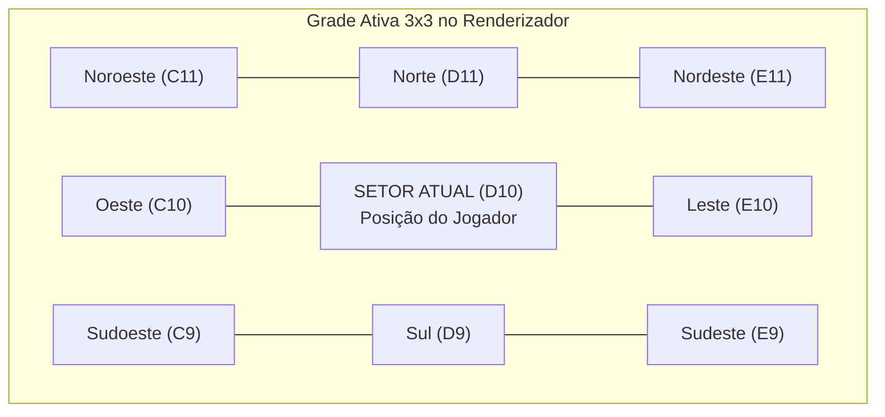
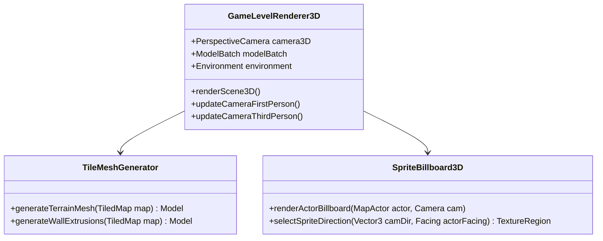

# Guia Definitivo de Engenharia Reversa e Modding: Exiled Kingdoms (Linux / Steam)
*Manual de Instruções e Diretrizes de Arquitetura para IA Gemini 3.8 Flash (High Thinking Mode) no Google Antigravity*

---

## 1. Mapeamento Técnico do Ecossistema do Jogo

O jogo **Exiled Kingdoms** (versão nativa Linux na Steam) **não é um executável binário compilado em C/C++**, mas sim uma aplicação **Java pura** construída sobre o framework **LibGDX (LWJGL)** empacotada com um launcher nativo ELF e uma JRE integrada.

### A. Estrutura de Diretórios na Steam
Local de instalação padrão no sistema:
`/home/yhn/.local/share/Steam/steamapps/common/Exiled Kingdoms/`

```
Exiled Kingdoms/
├── exiledkingdoms           # Launcher executável ELF 64-bit (Packr / JNI)
├── exiledkingdoms.jar       # O JOGO INTEIRO (~139 MB contendo código e assets)
├── config.json              # Configuração do launcher (Classpath, MainClass, JVM args)
├── init.ini                 # Resolução, fullscreen e parâmetros de vídeo
├── init_log.txt             # Log de inicialização do LibGDX e carregamento de dados
├── jre/                     # Java Runtime Environment bundled (OpenJDK 1.7 64-bit)
└── data/                    # Dados do usuário criados em tempo de execução
    ├── config/              # Configurações de input (controls.ini, keys.ini, settings.b)
    └── saves/               # Saves em slots (0/, 1/, 2/) e global.sav
```

### B. O Arquivo `config.json` e o Vetor Principal de Injeção
O launcher nativo inicializa a JVM lendo exatamente este arquivo:
```json
{
  "classPath": [
    "exiledkingdoms.jar"
  ],
  "mainClass": "net.fdgames.dr.desktop.Main",
  "vmArgs": [
    "-Xmx1G"
  ]
}
```

> [!TIP]
> **Vetor de Injeção Não-Destrutivo (Classpath Prepend)**:
> Ao alterar o `config.json` para `"classPath": ["mods/", "exiledkingdoms.jar"]`, o classloader do Java buscará **qualquer classe, textura, arquivo TMX ou script** primeiro dentro do diretório `mods/`. Se existir lá, ele sobrepõe o original imediatamente sem que seja necessário modificar ou reempacotar o `exiledkingdoms.jar`!

### C. Arquitetura de Classes Internas (Namespace `net.fdgames.*`)
O código do jogo possui pouquíssima ofuscação (apenas classes utilitárias e pontes com a Steam foram encurtadas). Todo o núcleo do jogo é composto por classes legíveis e altamente orientadas a objetos:

- `net.fdgames.dr.desktop.Main`: Ponto de entrada do executável desktop LibGDX.
- `net.fdgames.ek.ExiledKingdoms`: Classe raiz do jogo (`ApplicationListener`).
- `net.fdgames.GameWorld.GameWorld`: Instância do mundo, controle de quests (105 quests nativas), facções, rumores e áreas.
- `net.fdgames.GameLevel.GameLevel`: O nível ativo carregado, gerenciador de entidades e nós de pathfinding A*.
- `net.fdgames.GameLevel.GameLevelData`: Coleção de NPCs, monstros, baús, portas secretas, armadilhas e loot da cena atual.
- `net.fdgames.GameEntities.Final.Player`: Entidade do jogador, inventário, skills ativas, áreas visitadas e transições.
- `net.fdgames.GameEntities.Character`: Ficha do personagem (`sheet`), stats, HP, mana, ouro, buffs e animações de combate.
- `net.fdgames.TiledMap.c` (`GameMap`): Singleton do mapa ativo, matriz de colisão (`byte[][] d`) e grade de tiles.
- `net.fdgames.TiledMap.a` (`ADTIsometricTiledMapRenderer`): Renderizador isométrico customizado derivado do `BatchTiledMapRenderer` do LibGDX.
- `net.fdgames.Render.GameLevelRenderer`: Câmera ortográfica (`OrthographicCamera b`), sistema de partículas, shaders e iluminação dinâmica (`MapLight`).
- `net.fdgames.TiledMap.Objects.Transition`: Objeto responsável pelas telas de carregamento e troca de setores.

---

## 2. Nível 1: Modificações Simples (Interface, Balanceamento, Texturas, Textos e Saves)

### A. Edição do Save Game (`.sav`)
Os arquivos de save em `data/saves/0/game.sav` são codificados em **Base64** contendo internamente uma árvore de objetos serializados no formato **LibGDX Json**.

#### Como Descriptografar e Modificar:
1. **Decodificar para JSON puro**:
   ```bash
   base64 -d "/home/yhn/.local/share/Steam/steamapps/common/Exiled Kingdoms/data/saves/0/game.sav" > game_decoded.json
   ```
2. **Campos Editáveis no JSON**:
   - `player.sheet.gold`: Ouro atual do jogador.
   - `player.sheet.level`: Nível do personagem.
   - `player.sheet.skillPoints`: Pontos de habilidade disponíveis.
   - `player.sheet.traitPoints`: Pontos de atributos (Força, Agilidade, etc.).
   - `player.sheet.xp`: Experiência acumulada.
   - `player.inventory`: Array com os IDs dos itens nos slots de inventário e baú.
   - `player.x`, `player.y`: Posição absoluta em coordenadas de tile no mapa atual.
   - `areasVisited`: Array de setores descobertos no minimapa.
3. **Reencapsular para Base64**:
   ```bash
   base64 -w 0 game_decoded.json > "/home/yhn/.local/share/Steam/steamapps/common/Exiled Kingdoms/data/saves/0/game.sav"
   ```

### B. Modificando Regras, Itens, Armas e Monstros (Arquivos TSV)
Dentro de `exiledkingdoms.jar` em `data/rules/`, o jogo armazena suas tabelas no formato TSV (*Tab-Separated Values*):
- `data/rules/items.txt`: Lista de todos os itens do jogo.
- `data/rules/weapons.txt`: Atributos de armas (dano base, tipo de dano, velocidade).
- `data/rules/bestiary.txt`: Monstros, HP, defesa, resistências elementais, IA e tabelas de loot.
- `data/rules/skills.txt` e `skills_advanced.txt`: Custo de mana, cooldowns e fórmulas matemáticas das habilidades.

#### Estrutura do `items.txt`:
```tsv
item_ID	name	type	weaponstats	armor	resistances	traitBonus	attributes	value	icon	hp	mana	damage_bonus	Classes	stack
115	Platemail Vest	armor_chest		3				2300	armor_plate_chest	15	0		W	
```
*Para criar itens novos ou editar itens existentes*:
Basta alterar ou adicionar linhas mantendo a tabulação exata (`\t`) e salvar em `mods/data/rules/items.txt`.

### C. Modificação de Texturas e Interface (UI)
As texturas de interface estão compactadas no formato **LibGDX TextureAtlas**:
- `data/graphics/ui_icons.png` e `data/graphics/ui_icons.pack`
- `data/graphics/items.png` e `data/graphics/items.pack`
- `data/graphics/skills.png` e `data/graphics/skills.pack`

#### Como Extrair e Reempacotar Texturas:
1. Os arquivos `.pack` contêm os metadados de recorte de cada ícone:
   ```
   ui_icons.png
   format: RGBA8888
   filter: Nearest,Nearest
   repeat: none
   windrose
     rotate: false
     xy: 1, 749
     size: 176, 150
   ```
2. Você pode editar diretamente a imagem PNG com qualquer editor gráfico (GIMP, Aseprite, Photoshop) respeitando as posições `xy` e dimensões `size`.
3. Se for adicionar novos ícones ou redimensionar a interface, utilize o `RunnableTexturePacker` oficial do LibGDX para recompilar o `.pack` e a `.png`.

---

## 3. Módulo Especial: Equipamentos Visíveis no Personagem (Armas e Escudos em Tempo Real)

### A. Diagnóstico e Engenharia Reversa do Sistema de Sprites Compostos
No jogo base, trocar a armadura de peitoral (`armor_chest`) ou elmo (`armor_head`) altera visualmente a aparência do personagem (ex: couro, cota de malha, placas). Contudo, **ao equipar uma espada, machado, cajado, arco ou escudo, a arma não aparece visualmente nas mãos do personagem**.

A investigação aprofundada do código-fonte e dos assets dentro do `exiledkingdoms.jar` revelou um fato extraordinário:
> [!IMPORTANT]
> **O sistema de armas e escudos visíveis já foi 95% desenvolvido pela criadora do jogo!**
> Trata-se de um recurso cortado (*cut content*) deixado dormente:
> 1. **Todas as folhas de sprite de armas e escudos já estão desenhadas e empacotadas** no jogo em `data/sprites/composite/` (17 tipos de armas para mão primária e 5 tipos de mão secundária/escudos, tanto para masculino quanto feminino).
> 2. As dimensões de todas as texturas são estritamente idênticas ($1260 \times 1540$ pixels, RGBA transparente), perfeitamente alinhadas pixel a pixel com as animações de caminhar, atacar e repouso.
> 3. O arquivo de regras `data/rules/items.txt` **já possui a coluna 17 (`sprite`) preenchida** com a categoria exata de cada arma (ex: `longsword`, `dagger`, `shortsword`, `axe`, `mace`, `staff`, `shortbow`, `shield`, `buckler`).
> 4. A classe `CharacterInventory` **já possui os métodos prontos**: `inventory.m()` (retorna a tag de sprite da arma na mão principal) e `inventory.n()` (retorna a tag do escudo/item na mão secundária).
> 5. O sistema de invalidação de renderização (`GameLevelData.y()`) já limpa automaticamente `Player.spriteIndex = null` sempre que qualquer item é equipado no inventário via `CharacterInventory.a(int)` e `CharacterInventory.j()`.

### B. Por que as Armas Não Apareciam no Jogo Original?
Ao analisar o bytecode de `net.fdgames.GameEntities.Final.Player.ac()` (o método construtor de camadas de sprite composto), constatou-se que o desenvolvedor montou o empilhamento das camadas da seguinte forma:
1. `gender_clothes` ou `gender_{armor}` (Tronco)
2. `gender_{legs}` (Pernas)
3. `gender_head_{head}` (Cabeça/Elmo)
4. `gender_{cloak}` (Capa)

E **simplesmente esqueceu ou interrompeu a implementação antes de incluir as chamadas para as mãos (`mainhand` e `offhand`) no array `this.spriteIndex`**!

### C. Mapeamento dos Sprites Existentes no Motor
O jogo já contém nativamente as seguintes folhas de animação transparentes prontas para uso:
- **Armas (Mão Principal - `composite/{gender}_mainhand_{sprite}.png`)**:
  - `longsword` (Espadas Longas de Aço, Ferro, etc.)
  - `shortsword` (Espadas Curtas)
  - `dagger` (Adagas)
  - `axe` (Machados de mão)
  - `battleaxe` (Machados de batalha)
  - `mace` (Maças)
  - `hammer` / `warhammer` (Martelos de combate)
  - `maul` (Marretas pesadas)
  - `staff` (Cajados simples)
  - `greatstaff` (Cajados arcanos avançados)
  - `wand` (Varinhas mágicas)
  - `rod` (Cetros)
  - `shortbow` (Arcos curtos)
  - `longbow` (Arcos longos)
  - `greatbow` (Arcos compósitos de guerra)
  - `greatsword` / `zweihander` (Espadas de duas mãos)
- **Mão Secundária / Escudos (`composite/{gender}_offhand_{sprite}.png`)**:
  - `shield` (Escudo redondo/ferro)
  - `shield2` (Escudo de brasão/pipa)
  - `buckler` (Broquel)
  - `axe` (Empunhadura dupla de machado)
  - `sword` (Empunhadura dupla de espada)

### D. Código do Patch em Java (`Player.java` e `NPC.java`)
Para ativar o mod, basta estender/sobrepor o método `ac()` em `net.fdgames.GameEntities.Final.Player` e `net.fdgames.GameEntities.Final.NPC`:

```java
package net.fdgames.GameEntities.Final;

import com.badlogic.gdx.utils.Array;
import net.fdgames.GameEntities.MapActor.ActorState;
import net.fdgames.assets.GameAssets;

public class PlayerVisibleWeaponsPatch {

    public static void rebuildCompositeSprites(Player player) {
        if (player.spriteIndex == null) {
            player.spriteIndex = new Array<Integer>();
        }
        player.spriteIndex.clear();

        String gender = player.c(); // "male" ou "female"
        String armor = player.sheet.a(); // Peitoral
        String cloak = player.sheet.c(); // Capa
        String legs = player.sheet.d();  // Calças
        String head = player.sheet.inventory.k(); // Elmo

        String headSprite = head.isEmpty() ? "head" : "head_" + head;

        // 1. Camada de Roupa / Armadura de Tronco
        String torsoPath = armor.isEmpty() 
            ? "composite/" + gender + "_clothes" 
            : "composite/" + gender + "_" + armor;
        int torsoId = GameAssets.a(torsoPath);
        if (torsoId != -1) player.spriteIndex.add(torsoId);

        // 2. Camada de Pernas
        if (player.ao() != ActorState.e && !legs.isEmpty()) {
            int legsId = GameAssets.a("composite/" + gender + "_" + legs);
            if (legsId != -1) player.spriteIndex.add(legsId);
        }

        // 3. Camada de Cabeça / Elmo
        int headId = GameAssets.a("composite/" + gender + "_" + headSprite);
        if (headId != -1) player.spriteIndex.add(headId);

        // 4. Camada de Capa
        if (player.ao() != ActorState.e && !cloak.isEmpty()) {
            int cloakId = GameAssets.a("composite/" + gender + "_" + cloak);
            if (cloakId != -1) player.spriteIndex.add(cloakId);
        }

        // ==========================================
        // NOVO: 5. Camada da Arma na Mão Principal
        // ==========================================
        String mainhandSprite = player.sheet.inventory.m();
        if (mainhandSprite != null && !mainhandSprite.isEmpty()) {
            String weaponAsset = "composite/" + gender + "_mainhand_" + mainhandSprite;
            int weaponId = GameAssets.a(weaponAsset);
            if (weaponId != -1) {
                player.spriteIndex.add(weaponId);
            }
        }

        // ==========================================
        // NOVO: 6. Camada do Escudo / Mão Secundária
        // ==========================================
        String offhandSprite = player.sheet.inventory.n();
        if (offhandSprite != null && !offhandSprite.isEmpty()) {
            String offhandAsset = "composite/" + gender + "_offhand_" + offhandSprite;
            int offhandId = GameAssets.a(offhandAsset);
            if (offhandId != -1) {
                player.spriteIndex.add(offhandId);
            }
        }
    }
}
```

### E. Adicionando Armas com Texturas Únicas Customizadas
Caso você queira criar uma arma especial (ex: uma "Espada de Fogo" ou "Espada de Bluesteel") com uma aparência visual totalmente exclusiva que se diferencie da espada de aço comum:
1. Desenhe ou recolora a folha de sprite base de `male_mainhand_longsword.png`.
2. Salve a nova folha em:
   `mods/data/sprites/composite/male_mainhand_bluesteel.png` e
   `mods/data/sprites/composite/female_mainhand_bluesteel.png`.
3. Abra `mods/data/rules/items.txt`, localize a linha da espada desejada e mude a coluna 17 (`sprite`) de `longsword` para `bluesteel`.
4. Ao equipar a espada no jogo, a engine LibGDX automaticamente carregará e renderizará a textura exclusiva nas mãos do personagem!

### F. O Fim das "Armaduras Genéricas": 36 Armaduras, Elmos e Escudos Corrigidos com Sprites Únicos
No jogo original, o criador desenhou ícones coloridos e temáticos no inventário, mas por preguiça apontou grande parte das armaduras para os sprites cinzas genéricos (`mail`, `plate`, `leather`) ou até deixou tags vazias. Realizamos uma varredura exaustiva de todos os 432 equipamentos do jogo e geramos **40 novas folhas de textura completas** ($1260 \times 1540$ RGBA, preservando reflexos e sombras metálicas) para cobrir todas as armaduras especiais e elmos:

| Categoria Temática | Itens Afetados (IDs e Nomes) | Antigo (Genérico / Bug) | Novo Sprite Exclusivo |
| :--- | :--- | :---: | :---: |
| **Tolassiana Carmesim / Vermelha** | ID 137 (`Tolassian Chain Shirt`)<br>ID 141 (`Tolassian Chain Coif`) | `mail`<br>`""` (invisível!) | `mail_red`<br>`chain_red` |
| **Abençoada / Gelo Primordial (Azul)** | ID 127 (`Blessed Chain Shirt`), ID 131 (`Blessed Coif`)<br>ID 163 (`Primal Ice Chain`), ID 167 (`Primal Ice Coif`)<br>ID 172 (`Traitor's Chain`), ID 176 (`Traitor's Coif`) | `mail`<br>`chain` | `mail_blue`<br>`chain_blue` |
| **Malha da Floresta & Vélites (Verde)** | ID 122 (`Forest Chain Shirt`), ID 126 (`Forest Chain Coif`)<br>ID 156 (`Velites Chain Shirt`), ID 160 (`Velites Chain Coif`) | `mail`<br>`chain` | `mail_forest`<br>`chain_forest` |
| **Legião Imperial & Centurião (Dourada)** | ID 151 (`Legion Breastplate`), ID 155 (`Legion Helm`)<br>ID 222 (`Centurion Helm`) | `plate`<br>`plate` | `plate_gold`<br>`plate_gold` |
| **Placas Abençoadas & Sagradas (Azul)** | ID 142 (`Blessed Platemail Vest`)<br>ID 161 (`Blessed Platemail Helm`), ID 221 (`Holy Helm`) | `plate`<br>`plate` | `plate_blue`<br>`plate_blue` |
| **Cinzas / Obsidiana (Placas Negras)** | ID 250 (`Ashen Chestplate`)<br>ID 254 (`Ashen Helm`) | `plate`<br>`plate` | `plate_black`<br>`plate_black` |
| **Épica / Rosa Queimado Suave (Mirosiana e Thuramiam)** | ID 162 (`Myrosian Breastplate`), ID 171 (`Myrosian Helm`)<br>ID 232 (`Thuramiam Breastplate`), ID 236 (`Thuramiam Helm`)<br>ID 262 (`Jeweled Breastplate`) | `plate`<br>`plate` | `plate_epic` (Rosa escuro nobre)<br>`plate_epic` |
| **Pele de Troll & Caçador (Couro Verde)** | ID 132 (`Trollskin Cuirass`), ID 136 (`Trollskin Cap`)<br>ID 263 (`Hunter's Armor`) | `leather`<br>`leather` | `leather_green`<br>`leather_green` |
| **Capuzes Arcanos (Verde e Azul)** | ID 302 (`Apprentice Hood`)<br>ID 309 (`Journeyman Cap`), ID 312 (`Conjurer Hood`) | `hood` (marrom)<br>`hood` (marrom) | `hood_green`<br>`hood_blue` |
| **Escudos Carmesins / Vermelhos** | ID 182 (`Charred Buckler`), ID 188 (`Red Leather Buckler`)<br>ID 189 (`Red Leather Shield`) | `buckler` (aço)<br>`shield2` (azul) | `buckler_red`<br>`shield2_red` |
| **Correção de Elmos Faltantes / Mapeados Errado** | ID 104 (`Leather Cap`)<br>ID 119 (`Knight Helm`)<br>ID 210 (`Cowl of Fellowship`), ID 339 (`Hood of the Hermit`) | `""` (invisível!)<br>`chain` (coif em vez de elmo!)<br>`""` (invisível!) | `leather`<br>`plate` (elmo com viseira real!)<br>`hood` |

---

## 4. Nível 2: Modificações Intermediárias a Avançadas (Mundo Aberto Contínuo / Seamless Map Streaming)

### A. Diagnóstico: Por que Existem Telas de Carregamento?
Exiled Kingdoms é dividido em **149 setores isolados** (`data/tmx/*.tmx`). Cada setor externo é um mapa isométrico padronizado de **$96 \times 96$ tiles** ($64 \times 32$ pixels por tile).

A nomenclatura do mapa obedece a uma matriz de coordenadas cartográficas:
- Colunas: `A` até `H` (Oeste $\to$ Leste)
- Linhas: `1` até `15` (Norte $\to$ Sul)
- Exemplos: `D10` (Vale de Nekhar), `D11` (Norte de Nekhar), `C10` (Oeste de Nekhar).

Cada mapa define explicitamente em suas propriedades XML seus vizinhos:
```xml
<property name="exit_n" value="D11"/>
<property name="exit_s" value="D9"/>
<property name="exit_w" value="C10"/>
```

Quando o jogador caminha até a extremidade do setor, colide com um objeto da classe `net.fdgames.TiledMap.Objects.Transition`. O motor então:
1. Pausa o loop de renderização e exibe `LoadingScreen`.
2. Destrói o `GameLevel` atual e libera todos os sprites de NPCs da memória.
3. Faz o parsing do novo arquivo TMX via `TmxMapLoader`.
4. Spawna o jogador no `entry_id` correspondente na nova borda.

### B. Arquitetura para Mundo Aberto Contínuo (Sem Telas de Carregamento)

Para eliminar os carregamentos e unificar o mapa em um mundo contínuo, implementamos um **Gerenciador de Chunks 3x3 com Streaming Dinâmico**.



#### Passos de Implementação via Hook em Java (Bytecode / Byte Buddy / Substituição de Classe):

1. **Desativação do Gatilho de Transição Brusca**:
   Em `net.fdgames.GameEntities.Final.Player`, interceptar o método que checa transições:
   ```java
   // Se a transição for para um setor externo (outdoor) vizinho, não chamar loadLevel()!
   if (transition.area_id.matches("^[A-H][0-9]+$")) {
       SeamlessWorldManager.getInstance().onPlayerCrossBorder(transition.area_id, transition.entry_id);
       return; // Cancela a LoadingScreen original
   }
   ```

2. **Cálculo de Translação de Coordenadas Globais**:
   Cada setor possui $96 \times 96$ tiles. O mundo exterior possui uma coordenada global $(GX, GY)$:
   $$GX = (\text{Coluna} - 'A') \times 96 + \text{tileX}$$
   $$GY = (\text{Linha} - 1) \times 96 + \text{tileY}$$

3. **Renderização de Múltiplos Mapas TMX com Offset**:
   Em `net.fdgames.TiledMap.a` (`ADTIsometricTiledMapRenderer`), modificar o loop de renderização para iterar sobre a lista de chunks vizinhos ativos, aplicando uma matriz de translação antes de renderizar cada `TiledMapTileLayer`:
   ```java
   public void renderSeamlessChunks(OrthographicCamera camera, List<ActiveChunk> chunks) {
       for (ActiveChunk chunk : chunks) {
           Matrix4 transform = new Matrix4();
           // Converte o deslocamento em tiles do chunk para coordenadas isométricas da tela:
           float screenX = (chunk.offsetX - chunk.offsetY) * (tileWidth / 2.0f);
           float screenY = (chunk.offsetX + chunk.offsetY) * (tileHeight / 2.0f);
           transform.setToTranslation(screenX, screenY, 0);
           
           batch.setTransformMatrix(transform);
           for (MapLayer layer : chunk.tiledMap.getLayers()) {
               renderTileLayer((TiledMapTileLayer) layer);
           }
       }
       batch.setTransformMatrix(new Matrix4()); // Restaura matriz identidade
   }
   ```

4. **Background Loading Assíncrono com LibGDX `AssetManager`**:
   Ao se aproximar de 15 tiles da borda de um setor, o `AssetManager` carrega preventivamente o TMX do setor seguinte em uma thread secundária. A transição física de entidades ocorre de forma invisível quando o jogador cruza o tile $X=95 \to X=96$.

---

## 5. Nível 3: Modificações Hiper-Avançadas (Conversão para Perspectiva 3D: 1ª e 3ª Pessoa)

Inspirado nos mods avançados de *Project Zomboid*, *Diablo II 3D* e motores clássicos isométricos, é perfeitamente viável converter Exiled Kingdoms em um RPG 3D completo, pois o LibGDX já possui embutido um **motor 3D completo de alta performance** baseado em OpenGL (`com.badlogic.gdx.graphics.g3d.*`).

### A. Substituição da Câmera
No arquivo `net.fdgames.Render.GameLevelRenderer`, o jogo original instancia:
```java
public OrthographicCamera b;
```
Devemos estender o renderizador e introduzir uma `PerspectiveCamera`:
```java
public PerspectiveCamera camera3D;
// Configuração recomendada:
camera3D = new PerspectiveCamera(67.0f, Gdx.graphics.getWidth(), Gdx.graphics.getHeight());
camera3D.near = 0.1f;
camera3D.far = 1000.0f;
```

### B. Mapeamento dos Tiles 2D para Malha 3D (Extrusão Voxel / Plano 3D)

No plano isométrico original do Exiled Kingdoms:
- $Tile_X$ e $Tile_Y$ são eixos diagonais a 30 graus.
- No espaço 3D clássico, convertemos para um plano cartesiano horizontal $(X, Z)$, onde o eixo $Y$ representa a **altura** (elevação vertical).

$$\text{Mundo } X = Tile_X \times 2.0f$$
$$\text{Mundo } Z = Tile_Y \times 2.0f$$



1. **Chão e Terreno (Pisos)**:
   - Para cada célula de chão no TMX (`TiledMapTileLayer`), gera-se um quad horizontal 3D nos vértices:
     $(X, 0, Z), (X+1, 0, Z), (X+1, 0, Z+1), (X, 0, Z+1)$.
   - Aplica-se as coordenadas UV originais da textura contida no tileset (`.tsx`).
   - Todos os quads de mesmo material são combinados em uma única `Mesh` estática usando o `MeshBuilder` do LibGDX para garantir 60+ FPS sem draw calls excessivas.

2. **Muros, Paredes e Obstáculos (Extrusão Vertical)**:
   - Camadas com a propriedade de colisão (`collides = true` ou índice de colisão na matriz `byte[][] d` de `GameMap`) são extrudadas verticalmente:
     - Altura da parede: $Y$ de $0.0f$ até $3.0f$.
     - Gera-se um bloco cúbico texturizado (faces frontal, traseira, laterais e topo).

3. **Iluminação Dinâmica 3D com Sombras**:
   - O LibGDX `Environment` substitui o sistema 2D de luzes:
   ```java
   Environment env = new Environment();
   env.set(new ColorAttribute(ColorAttribute.AmbientLight, 0.3f, 0.3f, 0.35f, 1.0f));
   // Converte os MapLight originais do TMX em PointLights 3D reais:
   for (MapLight light : gameLevelData.lights) {
       env.add(new PointLight().set(light.color, light.x * 2.0f, 1.8f, light.y * 2.0f, light.radius * 2.0f));
   }
   ```

### C. Sistema de Billboards para Personagens e Inimigos
Os sprites de monstros, NPCs e o próprio jogador continuam sendo sprites 2D de alta definição (`TextureRegion`). No ambiente 3D, eles são renderizados como **Billboards Cilíndricos** (sempre orientados para o observador no eixo Y):

1. **Cálculo da Rotação do Billboard**:
   A normal do quad do sprite sempre se alinha com o vetor planar da câmera:
   $$\vec{V}_{billboard} = \text{Normalise}(\text{Pos}_{\text{Câmera}} - \text{Pos}_{\text{Entidade}})_{XZ}$$

2. **Seleção de Perspectiva do Sprite (Facing 8 Direções)**:
   O jogo possui sprites virados para Norte, Sul, Leste, Oeste, etc.
   Calcula-se o ângulo $\theta$ relativo entre a orientação da câmera e o vetor de movimento do ator:
   $$\Delta\theta = \text{atan2}(V_{cam}.z, V_{cam}.x) - \text{atan2}(V_{actor}.z, V_{actor}.x)$$
   - $\Delta\theta \approx 0^\circ \implies$ Renderiza sprite de **Costas**.
   - $\Delta\theta \approx 180^\circ \implies$ Renderiza sprite de **Frente**.
   - $\Delta\theta \approx \pm 90^\circ \implies$ Renderiza sprite de **Perfil Lateral**.

### D. Modos de Câmera: Terceira e Primeira Pessoa

#### 1. Modo Terceira Pessoa (Estilo Witcher / Dark Souls / Project Zomboid 3D Mod):
```java
public void updateThirdPersonCamera(Player player, float mouseDeltaX, float mouseDeltaY, float zoomDistance) {
    yaw += mouseDeltaX * mouseSensitivity;
    pitch = MathUtils.clamp(pitch + mouseDeltaY * mouseSensitivity, -20.0f, 60.0f);

    float radYaw = MathUtils.degreesToRadians * yaw;
    float radPitch = MathUtils.degreesToRadians * pitch;

    float camX = (player.x * 2.0f) - MathUtils.sin(radYaw) * MathUtils.cos(radPitch) * zoomDistance;
    float camY = 1.5f + MathUtils.sin(radPitch) * zoomDistance;
    float camZ = (player.y * 2.0f) - MathUtils.cos(radYaw) * MathUtils.cos(radPitch) * zoomDistance;

    camera3D.position.set(camX, camY, camZ);
    camera3D.lookAt(player.x * 2.0f, 1.5f, player.y * 2.0f);
    camera3D.up.set(0, 1, 0);
    camera3D.update();
}
```

#### 2. Modo Primeira Pessoa (Estilo Skyrim / Daggerfall / King's Field):
```java
public void updateFirstPersonCamera(Player player, float mouseDeltaX, float mouseDeltaY) {
    yaw += mouseDeltaX * mouseSensitivity;
    pitch = MathUtils.clamp(pitch - mouseDeltaY * mouseSensitivity, -85.0f, 85.0f);

    float eyeHeight = 1.70f; // Altura dos olhos do Claude/Player
    camera3D.position.set(player.x * 2.0f, eyeHeight, player.y * 2.0f);
    
    Vector3 direction = new Vector3(
        -MathUtils.sinDeg(yaw) * MathUtils.cosDeg(pitch),
        MathUtils.sinDeg(pitch),
        -MathUtils.cosDeg(yaw) * MathUtils.cosDeg(pitch)
    ).nor();

    camera3D.direction.set(direction);
    camera3D.up.set(0, 1, 0);
    camera3D.update();
    
    // Oculta o sprite do próprio jogador quando em 1ª pessoa
    player.visibleToPlayer = false;
}
```

#### 3. Remapeamento de Movimento WASD para Coordenadas 3D:
Em 3D, a tecla **W** move o personagem para onde a câmera aponta no plano horizontal, e **A/D** realizam strafe lateral:
```java
Vector3 moveDir = new Vector3();
if (Gdx.input.isKeyPressed(Input.Keys.W)) moveDir.add(camera3D.direction.x, 0, camera3D.direction.z);
if (Gdx.input.isKeyPressed(Input.Keys.S)) moveDir.sub(camera3D.direction.x, 0, camera3D.direction.z);
if (Gdx.input.isKeyPressed(Input.Keys.A)) moveDir.add(camera3D.direction.z, 0, -camera3D.direction.x);
if (Gdx.input.isKeyPressed(Input.Keys.D)) moveDir.sub(camera3D.direction.z, 0, -camera3D.direction.x);

moveDir.nor().scl(player.getSpeed() * Gdx.graphics.getDeltaTime());
player.x += moveDir.x / 2.0f;
player.y += moveDir.z / 2.0f;
```

---

## 6. Playbook de Execução para a IA Gemini 3.8 Flash no Antigravity

Quando for comandar o **Gemini 3.8 Flash** no Antigravity para criar qualquer mod em Exiled Kingdoms, instrua-o a seguir este protocolo exato:

### Etapa 1: Preparação do Ambiente de Modding
O assistente deve executar o setup inicial isolado:
```bash
# 1. Criação do diretório de workspace de mods
mkdir -p /home/yhn/Projetos/exiled-kingdoms-mod/mods
cd /home/yhn/Projetos/exiled-kingdoms-mod

# 2. Configuração do launcher para buscar a pasta de mods primeiro
cp "/home/yhn/.local/share/Steam/steamapps/common/Exiled Kingdoms/config.json" config.json.bak
sed -i 's|"classPath": \[|"classPath": \[\n    "/home/yhn/Projetos/exiled-kingdoms-mod/mods/",|' \
  "/home/yhn/.local/share/Steam/steamapps/common/Exiled Kingdoms/config.json"
```

### Etapa 2: Como Decompilar e Inspecionar Classes
Utilize o `javap` nativo já instalado ou extraia com utilitários jar:
```bash
# Inspecionar métodos, variáveis e assinaturas internas de qualquer classe
javap -p -s -cp "/home/yhn/.local/share/Steam/steamapps/common/Exiled Kingdoms/exiledkingdoms.jar" net.fdgames.GameLevel.GameLevel
```

### Etapa 3: Compilação de Classes Customizadas / Overrides
Qualquer classe modificada (por exemplo, uma versão estendida de `GameLevelRenderer` ou `ADTIsometricTiledMapRenderer`) pode ser compilada diretamente com o `javac` do sistema contra o jar do jogo:
```bash
javac -cp "/home/yhn/.local/share/Steam/steamapps/common/Exiled Kingdoms/exiledkingdoms.jar" \
  -d /home/yhn/Projetos/exiled-kingdoms-mod/mods/ \
  net/fdgames/Render/GameLevelRenderer.java
```

### Etapa 4: Teste e Validação
Para testar qualquer modificação sem precisar passar pela interface da Steam:
```bash
cd "/home/yhn/.local/share/Steam/steamapps/common/Exiled Kingdoms"
./exiledkingdoms
```
Ou inspecione o arquivo `init_log.txt` para verificar se os assets e regras foram lidos corretamente.
