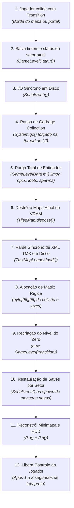
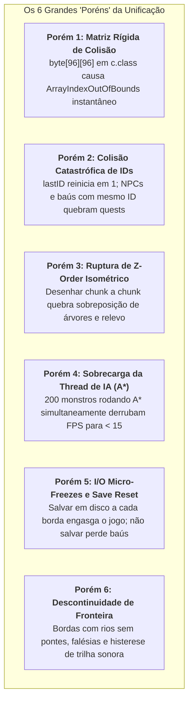

# Arquitetura de Missão Crítica: Mundo Aberto Contínuo (Seamless 3x3 Chunk Engine)
## *Exiled Kingdoms Overhaul — Especificação Técnica, Riscos e Blindagens*

---

## 1. Visão Geral e Mudança de Paradigma

A unificação dos mapas de **Exiled Kingdoms** em um mundo aberto contínuo (sem telas de carregamento) representa o ápice da complexidade da engenharia reversa deste projeto.

A abordagem ingênua (*"basta carregar vários arquivos TMX e desenhá-los juntos"*) colapsa imediatamente devido à arquitetura estática da engine herdada de 2015. Esta especificação formal estabelece a transição para um modelo de **Virtualização Completa de Subsistemas**: o jogo continuará acreditando que opera em um ambiente local, enquanto uma camada intermediária (*Middleware de Modding*) intercepta, particiona e virtualiza coordenadas, colisões, renderização e entidades.

---

## 2. Anatomia Forense da Engine Original (O Ponto de Ruptura)

### A. O Ciclo Destrutivo de Transição
Quando o jogador alcança a extremidade de um setor, o método [`net.fdgames.a.a.a(Transition)`](file:///home/yhn/Projetos/exiled-kingdoms-mod/scratch/GameScreen.java#L750) é acionado. A engine executa 12 passos destrutivos obrigatórios:



### B. Por que isso existia?
Em 2015, celulares de entrada rodavam Android com **1GB de RAM** e processadores de 32 bits de baixo clock. Descartar toda a memória da cena era indispensável para evitar *OutOfMemoryError*. 

No PC moderno (Linux/Windows), o hardware dispõe de gigabytes de RAM e CPUs multicore. O jogo original em execução consome irrisórios **~120MB de RAM**. Manter um grid $3 \times 3$ de setores vizinhos residentes em memória consome menos de **250MB de RAM** adicionais, o que é plenamente viável.

---

## 3. Os 6 Grandes "Poréns" (Riscos Críticos Auditados)

A auditoria implacável da skill **Guardião de Bugs** identificou 6 armadilhas estruturais no código-fonte do jogo. Qualquer tentativa de implementação sem blindar esses pontos destruirá o mod:



---

### Porém 1: A Matriz de Colisão Estática `byte[96][96]` (`BUG-MAP-01`)
* **A Armadilha**: A classe `net.fdgames.TiledMap.c` armazena a colisão física como `public byte[][] d`. Esse array é instanciado rigorosamente como `new byte[96][96]`.
* **O Colapso**: Quando o jogador, um monstro ou uma flecha chega no pixel 3073 (o início do setor vizinho), o código faz `tileX = 3073 / 32 = 96`. A instrução `this.d[96][y]` lança imediatamente `java.lang.ArrayIndexOutOfBoundsException`, abortando a thread LibGDX e fechando o jogo para a Área de Trabalho sem aviso de erro.
* **A Blindagem Obrigatória**: A matriz `c.d` não pode ser acessada diretamente. Devemos introduzir a fachada `VirtualCollisionGrid`, que mapeia coordenadas virtuais infinitas para a célula local correta do chunk ativo correspondente:
  $$\text{ChunkX} = \lfloor \text{GlobalTileX} / 96 \rfloor, \quad \text{LocalTileX} = \text{GlobalTileX} \pmod{96}$$

---

### Porém 2: A Colisão Catastrófica de IDs de Entidades (`BUG-MAP-02`)
* **A Armadilha**: Em `GameLevelData.java`, cada objeto (NPC, Monstro, Baú, Porta Secreta, Armadilha) recebe um número sequencial gerado por `public int lastID`, reiniciado em `1` a cada carregamento de mapa. Diálogos, scripts e o sistema de quests utilizam métodos como `GameLevel.b(int id)` para encontrar personagens.
* **O Colapso**: Se carregarmos o setor `D10` e o setor vizinho `D11` simultaneamente, ambos terão um monstro ou NPC com `ID = 4` e um baú com `ID = 7`. Se o jogador falar com o NPC do setor D10, o jogo buscará pelo ID 4 e poderá acionar a rotina de diálogo ou agressão do monstro do setor D11!
* **A Blindagem Obrigatória**: Particionamento de espaço de nomes por bit-shift:
  $$\text{GlobalUID} = (\text{ChunkIndex} \ll 16) \mid \text{LocalID}$$
  Nenhum ID no motor unificado poderá ser puro; todo identificador carregado de um TMX vizinho será encapsulado com o índice único do seu setor de origem.

---

### Porém 3: Ruptura de Profundidade Isométrica (Z-Order Collapse) (`BUG-MAP-03`)
* **A Armadilha**: O `BatchTiledMapRenderer` do LibGDX renderiza o mapa camada por camada. Em uma projeção ortogonal 2D comum (top-down), desenhar o Chunk 1 e depois o Chunk 2 funciona. Em **projeção isométrica $2:1$**, isso é impossível.
* **O Colapso**: Se desenharmos o Chunk Norte (`D11`) inteiro e depois o Chunk Sul (`D10`) inteiro: o chão de terra do Chunk Sul será desenhado por cima das copas das árvores e colunas de pedra da borda sul do Chunk Norte! O jogo parecerá despedaçado nas emendas.
* **A Blindagem Obrigatória**: Renderização por **Linhas Globais Entrelaçadas** (`InterleavedScanlineRenderer`). O laço de renderização deve iterar pelas diagonais de tela de Norte para Sul ($Y_{\text{screen}} = 0 \to \text{Max}$). Em cada linha de varredura, desenham-se os quads de todos os 3 chunks horizontais alinhados, preservando a sobreposição de profundidade perfeita.

---

### Porém 4: Saturação da CPU por Tick de Inteligência Artificial (`BUG-MAP-04`)
* **A Armadilha**: O algoritmo de pathfinding $A^*$ (`AStarPathFinder`) e os testes de linha de visão dos monstros rodam de forma síncrona na thread principal de gameplay.
* **O Colapso**: Um único setor externo possui entre 15 e 30 criaturas. Com 9 setores simultâneos em memória, teremos entre **150 e 250 monstros ativos**. Se todos rodarem $A^*$ a cada frame, o tempo de cálculo da CPU explodirá de 1ms para mais de 50ms por frame, derrubando a taxa de quadros de 60 FPS para menos de 15 FPS (jogo engasgado e injogável).
* **A Blindagem Obrigatória**: **Bolha de Simulação Ativa em 3 Círculos Concêntricos**:
  1. **Raio Imediato (< 35 tiles do jogador)**: Simulação completa (movimentação, IA, colisão, combate, animações).
  2. **Raio Periférico (35 a 70 tiles)**: Modo de dormência (*hibernation*). Os monstros congelam os cálculos de pathfinding $A^*$ e apenas monitoram se o jogador se aproximou.
  3. **Raio Distante (> 70 tiles)**: Entidades purgadas da memória de cena ativa e mantidas apenas no cache serializado de dados do chunk.

---

### Porém 5: O Dilema da Persistência e Micro-Travamentos de Disco (`BUG-MAP-05`)
* **A Armadilha**: No motor original, quando você mata um monstro ou abre um baú, essa informação só é gravada quando você sai do mapa via chamada síncrona `Serializer.h()`.
* **O Colapso**:
  * *Cenário A*: Se não serializarmos ao cruzar setores, ao andar 2 mapas para frente e depois voltar, todos os monstros mortos renascerão e baús abertos se fecharão magicamente na sua frente.
  * *Cenário B*: Se chamarmos o `Serializer.h()` original do jogo a cada mudança de chunk, a escrita síncrona de arquivos `.sav` no disco causará uma "travadinha" (*stutter*) perceptível de ~50ms a cada fronteira cruzada.
* **A Blindagem Obrigatória**: **Snapshot Deltas em Memória RAM (`RAMLevelSnapshot`)**:
  * Ao descarregar um chunk da grade 3x3, as modificações (monstros mortos, baús abertos) são gravadas instantaneamente em uma tabela hash na memória RAM (`ConcurrentHashMap<String, ChunkDelta>`).
  * A gravação física no disco só ocorrerá quando o jogador acionar o Quicksave (`F5`), salvar na fogueira ou sair do jogo.

---

### Porém 6: Descontinuidades Geográficas e Conflitos de Trilha Sonora (`BUG-MAP-06`)
* **A Armadilha 1 (Geografia)**: Nem todas as bordas dos 149 mapas foram desenhadas como estradas abertas. Existem montanhas intransponíveis e oceanos projetados para bloquear a passagem. Além disso, capitais como New Garand (`NG.tmx`) têm muralhas com portões.
* **A Armadilha 2 (Áudio)**: Cada TMX define sua própria trilha (ex: `D10` toca `"decline"`, `E10` toca `"varsilia"`). Se o jogador ficar se movendo para frente e para trás sobre a linha invisível da fronteira, a engine entrará em loop parando e recomeçando músicas no OpenAL, gerando estalos de áudio e possível crash no driver de som.
* **A Blindagem Obrigatória**:
  * **Histerese de Fronteira de Áudio**: A música só troca quando o jogador penetrar mais de **10 tiles para dentro** do novo território.
  * **Distinção Rígida: Outdoors vs Indoors**:
    * **Outdoors (`C3` a `K13`, `NG`, `FT`, `NI`, `IM`)**: 100% contínuos e sem loading.
    * **Indoors (Dungeons, Cavernas, Esgotos, Casas)**: Mantêm transição clássica, mas acelerada com um *fade* suave de 150ms sem carregamento perceptível.

---

## 4. O Projeto de Engenharia: A Arquitetura em Camadas

```mermaid
graph TD
    subgraph Core_Engine [Camada Superior de Gameplay]
        PL[Player & Companions]
        AI[NPCs & Monsters AI]
        Cam[OrthographicCamera]
    end

    subgraph Seamless_Middleware [Middleware do Overhaul (Injeção Bytecode)]
        SWM[SeamlessWorldManager<br/>Orquestrador Central]
        Grid[VirtualCollisionGrid<br/>Fachada de Matriz Infinita]
        Bubble[ActiveSimulationBubble<br/>Gestor de CPU e Dormência]
        Snap[RAMDeltaSnapshot<br/>Persistência em Memória]
        Rend[InterleavedScanlineRenderer<br/>Renderizador Multi-TMX Z-Sorted]
    end

    subgraph Native_Game [Motor Nativo LibGDX]
        TMX[Arquivos TMX em data/tmx/]
        GLD[GameLevelData Singleton]
        Audio[LibGDX Audio Engine]
    end

    PL --> SWM
    AI --> Bubble
    Bubble --> Grid
    Cam --> Rend
    SWM --> Grid
    SWM --> Snap
    SWM --> Rend
    Rend --> TMX
    Snap --> GLD
    SWM --> Audio
```

---

## 5. Roteiro Crítico de Execução em 5 Fases

| Fase | Foco Técnico | Pré-requisitos & Portão de Qualidade |
| :---: | :--- | :--- |
| **Fase 1** | **Topologia da Grade & Grafo do Mundo** | Mapear e catalogar em arquivo JSON/Java todos os setores externos, suas coordenadas absolutas e suas conexões norte/sul/leste/oeste. |
| **Fase 2** | **A Fachada da Matriz de Colisão (`VirtualCollisionGrid`)** | Interceptar consultas a `c.d[x][y]` via Javassist e provar por teste unitário que coordenadas além de 96 não lançam exceção. |
| **Fase 3** | **Renderizador Multi-TMX Intercalado** | Desenhar 2 mapas adjacentes (`D10` e `D11`) simultaneamente na tela com matriz de projeção unificada e Z-order testado. |
| **Fase 4** | **Particionamento de Entidades e Bolha de IA** | Subir a grade 3x3 com a bolha de dormência a 48 tiles, comprovando 60 FPS estáveis com 100+ monstros na área. |
| **Fase 5** | **Persistência em RAM e Tratamento de Áudio** | Testar savegames, baús, colheita de plantas e transições de trilha sonora com histerese de 10 tiles. |

---

> [!IMPORTANT]
> **Decisão Estratégica**: Não implementaremos código às cegas. Cada fase terá um teste de estresse de borda antes de passarmos para a fase seguinte.
