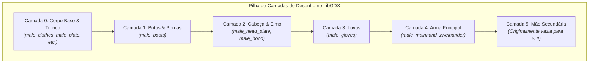
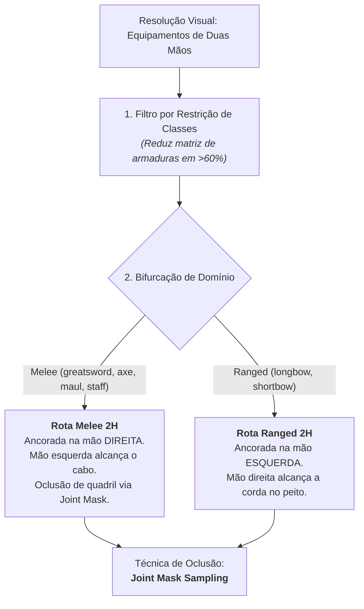

# Relatório Forense de Engenharia: A Arquitetura das Armas de Duas Mãos
## *Exiled Kingdoms Overhaul — Diagnóstico Anatômico, Limitações de Engine e Projetos de Resolução*

---

## 1. Sumário Executivo

Em **Exiled Kingdoms**, equipar uma arma de duas mãos (como uma *Iron Greatsword*, *Minotaur Axe*, *Staff of the Arcanist* ou *Oaken Bow*) desativa funcionalmente o slot de mão secundária (*offhand*). No entanto, no modelo visual do personagem em jogo, a arma continua sendo segurada por apenas **uma única mão** (a direita), enquanto o braço esquerdo permanece inerte e solto ao lado da cintura.

Este relatório documenta a anatomia forense desse problema no código do jogo original, explica matematicamente e artisticamente por que abordagens automáticas/procedurais falham (como comprovado empiricamente na aberração visual registrada na captura de tela), e estabelece as 3 rotas de engenharia viáveis para implementação futura.

---

## 2. Anatomia Forense da Engine Original (O Código-Fonte)

### A. A Supressão Rígida em `CharacterSheet.java`
No descompilador de `CharacterSheet.class`, o método `d()` é o responsável por determinar o que deve ser desenhado na mão secundária (*offhand*):

```java
public final String d() {
    Object object = this.inventory;
    Object object2 = object = ((CharacterInventory)object).slot_offhand > 0 && 
        !Rules.c((int)((CharacterInventory)object).slot_offhand).sprite.equals("") ? 
        Rules.c((int)((CharacterInventory)object).slot_offhand).sprite : "";
    if (this.inventory == null || this.inventory.o() == null) {
        return "";
    }
    // LINHA CRÍTICA DO MOTOR ORIGINAL:
    if (this.inventory.o().twohanded) {
        return "";
    }
    if (!((String)object).equals("")) {
        return "offhand_" + (String)object;
    }
    return "";
}
```

O desenvolvedor original inseriu uma regra estrita: `if (this.inventory.o().twohanded) return "";`. Quando uma arma de duas mãos está equipada, a engine descarta qualquer tentativa de compor a mão secundária e retorna uma string vazia.

### B. O Ciclo de Composição de Camadas em `Player.ac()` e `Player.a()`
A renderização de personagens no LibGDX utiliza o conceito de **Composição de Texturas em Camadas** (*Layered Sprite Composition*):



Quando a Camada 4 desenha `male_mainhand_zweihander.png`, ela projeta apenas a **lâmina e a empunhadura metálica** sobre as coordenadas da mão direita. Como a Camada 5 fica vazia, o personagem exibe o braço esquerdo desenhado nativamente na Camada 0 (que foi desenhado em 2015 em pose relaxada, com o braço esticado ao lado da coxa).

---

## 3. O Censo dos 80 Equipamentos de Duas Mãos

Uma varredura completa nas tabelas de dados do jogo (`data/rules/weapons.txt` e `mods/data/rules/items.txt`) catalogou exatamente **80 armas de duas mãos** (`2-handed == 1`):

| Família Visual | Qtd | Arquétipos de Sprite | Exemplos Notáveis |
| :--- | :---: | :--- | :--- |
| **Arcos Longos e Curtos** | 22 | `shortbow`, `longbow` | *Composite Bow*, *Hunter's Mark*, *Silver Bow of Malan* |
| **Cajados Arcanos** | 18 | `greatstaff`, `staff` | *Staff of the Arcanist*, *First Winter*, *Tesla Rod* |
| **Espadões & Montantes** | 15 | `zweihander`, `greatsword` | *Iron Greatsword*, *Adamantite Greatsword*, *Cruelty* |
| **Marretas & Martelos** | 14 | `maul` | *Iron Maul*, *Gurgurth's Maul*, *Maul of Terror* |
| **Machados de Guerra** | 11 | `battleaxe` | *Minotaur Axe*, *Soul Drinker*, *Axe of the Depths* |

Todas as 80 armas utilizam exclusivamente uma grade padronizada de $9 \text{ colunas} \times 11 \text{ linhas}$ de células de $140 \times 140\text{ px}$ em uma folha $1260 \times 1540\text{ px}$.

---

## 4. Por que Abordagens Procedurais e Premissas Ingênuas Falham?

A tentativa empírica e a auditoria crítica formal do **Guardião de Bugs** revelaram os nós górdios da engine:

### A. A Falsa Simetria entre Arcos e Armas Melee (`BUG-2H-AUDIT-01`)
* Em `longbow.png` e `shortbow.png`, a arma já fica ancorada nativamente na mão **esquerda** do personagem em $(69, 103)$, deixando o braço direito inerte.
* Em armas melee (`greatsword`, `battleaxe`, `maul`, `staff`), a arma fica ancorada na mão **direita** em $(94, 99)$, deixando o braço esquerdo inerte.
* Uma lógica homogênea que faça a mão esquerda buscar o cabo funciona para espadas, mas é desastrosa para arcos (a mão esquerda tentaria alcançar a si mesma, enquanto a mão direita ficaria vazia). É mandatório bifurcar a cinemática:
  - **Melee 2H:** Mão esquerda busca o cabo da arma na mão direita.
  - **Ranged 2H (Arcos):** Mão direita busca a corda/flecha na altura do peito/ombro esquerdo.

### B. O Colapso Cinemático de "Arma no Ombro" na Caminhada e Ataque (`BUG-2H-AUDIT-02`)
* A ideia ingênua de apoiar espadões no ombro só funciona no estado inativo (*Idle*, `ActorState.a`).
* Durante a caminhada (`ActorState.b`, 8 frames), os ombros oscilam e a lâmina atravessaria a cabeça e o elmo.
* No ataque (`ActorState.c`, 4 frames de golpe vertical/diagonal), o braço executa um arco descendente. Se a arma estiver fixa no ombro, ela flutua desconectada no ar enquanto as mãos golpeiam o vazio. A arma **deve** acompanhar o vetor de ataque.

### C. O Paradoxo do "Braço Triplo" e Incompatibilidade Vetorial
* No spritesheet de corpo (`male_naked.png`, `male_plate.png`), o braço esquerdo já está gravado nos pixels entre $X \in [61, 77]$ e $Y \in [87, 119]$.
* Linhas procedurais ou primitivas geométricas quebram o estilo pré-renderizado/pixel art do jogo, produzindo artefatos como o "bastão marrom" registrado na captura de tela:


---

## 5. A Arquitetura Reestruturada: Rotas Viáveis e Mitigação de Escopo

O laudo do Guardião de Bugs redefiniu as rotas viáveis, desmistificando o mito de que seria necessário recriar todas as 40 armaduras:



### 1. Otimização do Grafo de Classes (`BUG-2H-AUDIT-03`)
Não é necessário suportar 40 armaduras para todas as armas de duas mãos, devido às regras de classe do jogo:
* **Guerreiro (Warrior):** Apenas `greatsword`, `zweihander`, `battleaxe`, `maul`, `shortbow`, `longbow`.
* **Mago (Mage):** Apenas `staff`, `greatstaff` (não usa armaduras de placas nem couro pesado).
* **Ladino (Rogue):** Apenas `shortbow`, `longbow` (não usa espadões nem placas).
* **Clérigo (Cleric):** Apenas `maul` de duas mãos.
Essa separação reduz drasticamente o volume de combinações visuais necessárias.

### 2. A Técnica de Oclusão: *Joint Mask Sampling* (`BUG-2H-AUDIT-04`)
Para eliminar o braço relaxado da cintura sem a necessidade de desenhar dezenas de corpos do zero:
1. **Injeção na Camada 5 (Offhand):** Desenha a luva secundária empunhando o cabo da arma ou puxando a corda do arco.
2. **Máscara de Amostragem Local (*Joint Mask*):** Um retângulo de amortecimento de $14 \times 20\text{ px}$ é amostrado dinamicamente da textura da armadura/tronco equipada (na mesma célula de animação) e sobreposto exatamente sobre a posição do braço inerte na cintura.
3. Como a textura amostrada pertence à própria armadura em uso, o braço da cintura é perfeitamente camuflado pela própria estampa da armadura, eliminando o efeito do braço triplo de forma nativa e limpa.

### 3. Suporte a Companheiros e NPCs (`BUG-2H-AUDIT-05`)
A injeção visual deve cobrir não apenas o jogador (`Player.ac()`), mas também os companheiros que utilizam armas de duas mãos (como Grissenda com espadões/mauls ou Adaon com arcos), respeitando a alternância entre modo companheiro ativo e modo repouso em tavernas.

---

> [!NOTE]
> Este módulo fica formalmente congelado e arquivado nesta especificação para que possamos avançar imediatamente para a **criação dos Instaladores Universais (Linux & Windows)**.
