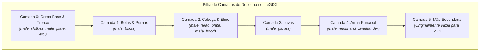
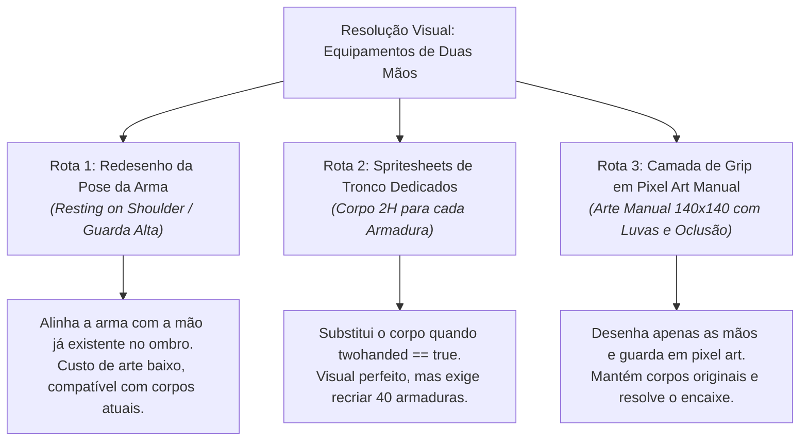

# Relatório Forense de Engenharia: A Arquitetura das Armas de Duas Mãos
## *Exiled Kingdoms Overhaul — Diagnóstico Anatômico, Limitações de Engine e Projetos de Resolução*

---

## 1. Sumário Executivo

Em **Exiled Kingdoms**, equipar uma arma de duas mãos (como uma *Iron Greatsword*, *Minotaur Axe*, *Staff of the Arcanist* ou *Oaken Bow*) desativa funcionalmente o slot de mão secundária (*offhand*). No entanto, no modelo visual do personagem em jogo, a arma continua sendo segurada por apenas **uma única mão** (a direita), enquanto o braço esquerdo permanece inerte e solto ao lado da cintura.

Este relatório documenta a anatomia forense desse problema no código do jogo original, explica matematicamente e artisticamente por que abordagens automáticas/procedurais falham (como comprovado empiricamente na aberração visual registrada na captura de tela), e estabelece as 3 rotas de engenharia viáveis para implementação futura.

---

## 2. Anatomia Forense da Engine Original (O Código-Fonte)

### A. A Supressão Rígida em `CharacterSheet.java`
No descompilador de `CharacterSheet.class`, o método `d()` é o responsável por determinar o que deve ser desenhado na mão secundária (*offhand*):

```java
public final String d() {
    Object object = this.inventory;
    Object object2 = object = ((CharacterInventory)object).slot_offhand > 0 && 
        !Rules.c((int)((CharacterInventory)object).slot_offhand).sprite.equals("") ? 
        Rules.c((int)((CharacterInventory)object).slot_offhand).sprite : "";
    if (this.inventory == null || this.inventory.o() == null) {
        return "";
    }
    // LINHA CRÍTICA DO MOTOR ORIGINAL:
    if (this.inventory.o().twohanded) {
        return "";
    }
    if (!((String)object).equals("")) {
        return "offhand_" + (String)object;
    }
    return "";
}
```

O desenvolvedor original inseriu uma regra estrita: `if (this.inventory.o().twohanded) return "";`. Quando uma arma de duas mãos está equipada, a engine descarta qualquer tentativa de compor a mão secundária e retorna uma string vazia.

### B. O Ciclo de Composição de Camadas em `Player.ac()` e `Player.a()`
A renderização de personagens no LibGDX utiliza o conceito de **Composição de Texturas em Camadas** (*Layered Sprite Composition*):



Quando a Camada 4 desenha `male_mainhand_zweihander.png`, ela projeta apenas a **lâmina e a empunhadura metálica** sobre as coordenadas da mão direita. Como a Camada 5 fica vazia, o personagem exibe o braço esquerdo desenhado nativamente na Camada 0 (que foi desenhado em 2015 em pose relaxada, com o braço esticado ao lado da coxa).

---

## 3. O Censo dos 80 Equipamentos de Duas Mãos

Uma varredura completa nas tabelas de dados do jogo (`data/rules/weapons.txt` e `mods/data/rules/items.txt`) catalogou exatamente **80 armas de duas mãos** (`2-handed == 1`):

| Família Visual | Qtd | Arquétipos de Sprite | Exemplos Notáveis |
| :--- | :---: | :--- | :--- |
| **Arcos Longos e Curtos** | 22 | `shortbow`, `longbow` | *Composite Bow*, *Hunter's Mark*, *Silver Bow of Malan* |
| **Cajados Arcanos** | 18 | `greatstaff`, `staff` | *Staff of the Arcanist*, *First Winter*, *Tesla Rod* |
| **Espadões & Montantes** | 15 | `zweihander`, `greatsword` | *Iron Greatsword*, *Adamantite Greatsword*, *Cruelty* |
| **Marretas & Martelos** | 14 | `maul` | *Iron Maul*, *Gurgurth's Maul*, *Maul of Terror* |
| **Machados de Guerra** | 11 | `battleaxe` | *Minotaur Axe*, *Soul Drinker*, *Axe of the Depths* |

Todas as 80 armas utilizam exclusivamente uma grade padronizada de $9 \text{ colunas} \times 11 \text{ linhas}$ de células de $140 \times 140\text{ px}$ em uma folha $1260 \times 1540\text{ px}$.

---

## 4. Por que Abordagens Procedurais/Automáticas Falham?

A tentativa empírica de gerar um braço secundário através de código procedural revelou os dois grandes nós górdios da engine:

### A. O Paradoxo do "Braço Triplo" (Efeito Ganesha)
* No spritesheet de corpo (`male_naked.png`, `male_plate.png`), o braço esquerdo já está gravado nos pixels entre $X \in [61, 77]$ e $Y \in [87, 119]$.
* Se um script desenhar um segundo braço estendido em direção à espada, o jogador verá **dois braços esquerdos**: um estendido até a espada e outro pendurado na cintura.
* Tentar "apagar" o braço da cintura via máscara opaca é inviável, pois embaixo do braço existem diferentes texturas de fundo (tecido de túnica, couro, armadura de placas brancas, cota de malha vermelha, etc.).

### B. Incompatibilidade com o Estilo Artístico Pixel Art
* O jogo utiliza arte 2D pré-renderizada com sombreamento baked, paleta de cores terrosa e traços específicos de iluminação.
* Linhas vetoriais ou primitivas geométricas (`draw.line`, `draw.ellipse`) quebram imediatamente a harmonia visual, gerando artefatos destoantes que se assemelham a "paus de madeira" ou "alavancas", como documentado na captura de tela:


---

## 5. As 3 Rotas de Engenharia para a Solução Definitiva

Para quando este módulo for retomado, a solução deverá seguir uma das 3 rotas formais abaixo:



### Rota 1: Postura da Arma no Ombro (*Resting on Shoulder*) — *Recomendada para Armas Pesadas*
* Em jogos clássicos e ilustrações medievais, espadões e machados de guerra são carregados apoiados sobre o ombro direito, com a mão direita segurando o cabo próximo ao peito.
* **Vantagem:** Utiliza a anatomia já existente do corpo do personagem, dispensando a necessidade de reposicionar o braço esquerdo durante a caminhada.

### Rota 2: Spritesheet de Tronco de Duas Mãos (*Dedicated 2H Body Stance*)
* Criar variantes `male_plate_2h.png`, `male_clothes_2h.png`, onde o próprio modelo corporal foi desenhado com ambos os braços erguidos em postura de combate de duas mãos.
* **Vantagem:** Elimina completamente o problema de braços sobrepostos e oferece a animação mais bonita e profissional possível.
* **Trade-off:** Exige desenhar os frames de corpo para cada um dos conjuntos de armadura do jogo.

### Rota 3: Luvas e Empunhadura em Pixel Art Manual (*Handcrafted Pixel Art Overlay*)
* Em vez de código procedural, desenhar manualmente em software de pixel art (Aseprite / GIMP) a luva/manopla segurando a empunhadura para cada uma das 5 direções, respeitando a paleta e iluminação do jogo.

---

> [!NOTE]
> Este módulo fica formalmente congelado e arquivado nesta especificação para que possamos avançar imediatamente para a **criação dos Instaladores Universais (Linux & Windows)**.
