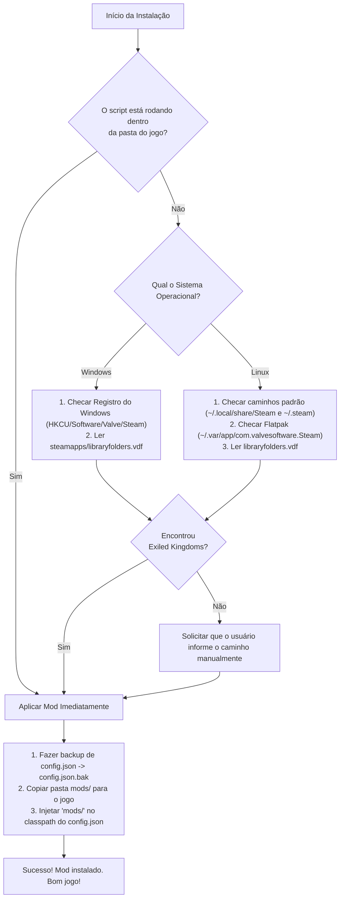

# Plano de Ação: Distribuição Universal e Multiplataforma (Linux & Windows)
## *Exiled Kingdoms Overhaul — Arquitetura de Releases e Instalação Amigável*

---

## 1. Visão Geral e Objetivo

O objetivo deste plano é transformar o **Exiled Kingdoms Overhaul** em um mod **"1-Click Install"** tanto para **Linux** quanto para **Windows**. 

Qualquer jogador na Steam, mesmo sem conhecimento técnico de terminal, programação ou modding, deve ser capaz de:
1. Baixar o arquivo `ExiledKingdomsOverhaul-vX.Y.Z.zip` na aba **Releases** do GitHub.
2. Extrair o arquivo em qualquer pasta.
3. Clicar duas vezes em `install.bat` (Windows) ou executar `./install.sh` (Linux).
4. Abrir o jogo diretamente pela Steam e jogar com todas as melhorias ativas.

---

## 2. Comparativo da Arquitetura do Jogo: Linux vs Windows

Como o Exiled Kingdoms é desenvolvido em **Java / LibGDX**, a boa notícia é que **95% do jogo é estritamente idêntico entre sistemas operacionais**.

| Componente | Versão Linux (Steam) | Versão Windows (Steam) | Impacto no Mod |
| :--- | :--- | :--- | :--- |
| **Núcleo do Jogo** | `exiledkingdoms.jar` (~139 MB) | `exiledkingdoms.jar` (~139 MB) | **Idêntico** (mesmo bytecode Java) |
| **Config do Launcher** | `config.json` | `config.json` | **Idêntico** (Packr JSON) |
| **Assets & Sprites** | `data/` (PNG, TSV, TMX) | `data/` (PNG, TSV, TMX) | **Idêntico** |
| **Java Runtime (JRE)** | `jre/bin/java` (ELF 64-bit) | `jre/bin/java.exe` / `javaw.exe` | Embarcado no diretório do jogo |
| **Executável Launcher** | `exiledkingdoms` (ELF nativo) | `Exiled Kingdoms.exe` (PE nativo) | Ambos leem o mesmo `config.json` |
| **Caminho Padrão Steam** | `~/.local/share/Steam/steamapps/...` | `C:\Program Files (x86)\Steam\steamapps\...` | Requer detecção automática |

> [!NOTE]
> **Conclusão Técnica Crucial**: Não precisamos recompilar o jogo para Windows! O mesmo pacote de mods em bytecode Java 7 (`mods/`) e os mesmos spritesheets funcionam **nativamente e de forma idêntica** em ambos os sistemas operacionais.

---

## 3. Experiência do Usuário (Estrutura do Pacote de Release)

Quando gerarmos uma release no GitHub, o arquivo compactado conterá esta estrutura limpa:

```
ExiledKingdomsOverhaul-v1.0.0/
├── install.bat          # Instalador em 1 clique para Windows
├── install.sh           # Instalador em 1 clique para Linux
├── uninstall.bat        # Desinstalador / Restaurador para Windows
├── uninstall.sh         # Desinstalador / Restaurador para Linux
├── README.txt           # Instruções rápidas em texto puro
└── mods/                # O conteúdo completo do mod pré-compilado
    ├── net/             # Bytecodes Java 7 (.class) prontos para injeção
    │   └── fdgames/
    │       ├── mods/EquipmentVisuals.class
    │       └── GameEntities/Final/Player.class e NPC.class
    └── data/
        ├── rules/items.txt
        └── sprites/composite/*.png (40 texturas de armaduras e escudos)
```

---

## 4. Detecção Automática da Pasta da Steam

O maior atrito para jogadores é encontrar onde o jogo está instalado (muitos usam discos secundários como `D:\SteamLibrary` ou instalações Flatpak no Linux). O instalador resolverá isso automaticamente:



---

## 5. Implementação dos Scripts de Instalação

### A. Para Windows (`install.bat`)
Script em lote (Batch) nativo, sem exigir que o jogador instale PowerShell moderno, Python ou Java:
- Detecta a pasta do Steam via registro:
  `reg query "HKCU\Software\Valve\Steam" /v SteamPath`
- Varre o arquivo `libraryfolders.vdf` para encontrar se o jogo está no disco `C:`, `D:`, `E:`, etc.
- Copia a pasta `mods/` para o diretório de destino.
- Atualiza o `config.json` usando uma chamada nativa do PowerShell (que já vem pré-instalado em qualquer Windows 7, 10 ou 11) ou VBScript embutido.

### B. Para Linux (`install.sh`)
Script POSIX Bash ultra-robusto:
- Testa os diretórios nativos padrão:
  * `$HOME/.local/share/Steam/steamapps/common/Exiled Kingdoms`
  * `$HOME/.steam/steam/steamapps/common/Exiled Kingdoms`
  * `$HOME/.var/app/com.valvesoftware.Steam/.local/share/Steam/steamapps/common/Exiled Kingdoms` (Steam Flatpak)
- Lê `libraryfolders.vdf` para partições montadas em `/mnt/jogos`, `/media/`, etc.
- Atualiza o `config.json` usando `sed`.

---

## 6. Automação de CI/CD com GitHub Actions

Para que não tenhamos trabalho manual ao lançar novas versões, configuraremos um fluxo de trabalho automatizado no GitHub (`.github/workflows/release.yml`):

1. **Gatilho**: Sempre que criarmos uma tag de versão (ex: `v1.0.0`, `v1.1.0`).
2. **Ambiente de Build do GitHub**:
   * O GitHub inicia uma máquina virtual Ubuntu gratuita.
   * Compila o código Java de `src/` gerando os bytecodes compatíveis com Java 7.
   * Executa os patches de bytecode em `Player.class` e `NPC.class`.
   * Monta o pacote zip com `install.bat`, `install.sh`, `uninstall.bat`, `uninstall.sh` e a pasta `mods/`.
3. **Publicação Automática**:
   * O GitHub Actions cria a Release automaticamente, anexa o arquivo `.zip` para download público e gera as notas de atualização (Changelog).

---

## 7. Próximos Passos do Plano

| Etapa | Ação Técnica | Complexidade | Status |
| :---: | :--- | :---: | :---: |
| **Fase 1** | Criação do repositório no GitHub e envio da base atual do projeto | Baixa | **Em andamento** |
| **Fase 2** | Desenvolver os scripts `install.sh` e `install.bat` universais com busca automática de biblioteca Steam | Média | Pendente |
| **Fase 3** | Criar script local `package_release.sh` para testar a geração do `.zip` da release | Baixa | Pendente |
| **Fase 4** | Configurar o workflow do GitHub Actions para compilação e publicação automática de releases | Média | Pendente |
